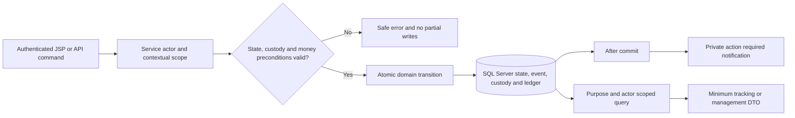

# Phase 05: Cross-slice Integration - Research

**Researched:** 2026-10-25  
**Snapshot:** merged checkout `main@ca2bbf8`  
**Domain:** Internal workflow, service, persistence and authorization integration audit  
**Result:** `GAPS_FOUND`; ready to replan, not integration-verified.

<user_constraints>
## User Constraints (from CONTEXT.md)

The following implementation decisions, discretion and deferred ideas are copied verbatim from Phase 05 context. [VERIFIED: .planning/phases/05-cross-slice-integration/05-CONTEXT.md]

## Implementation Decisions

### Integration verification and fixtures

- **D-01:** Use real SQL Server automated journey suites for core end-to-end invariants. Manual UAT is limited to browser/JSP and authenticated STOMP proof. A skipped SQL Server test is `BLOCKED_BY_ENVIRONMENT`, never a pass. — **Reversibility:** costly — test topology, fixture ownership, and the evidence expected for the phase depend on a real SQL Server boundary.
- **D-02:** Provide idempotent local SQL Server seed/reset scripts for users, hubs, routing rules, prices, assignments, and financial fixtures. Scripts must not commit passwords, JWT secrets, or other credentials. — **Reversibility:** costly — deterministic fixtures are shared by all normal/exception journeys and manual UAT.
- **D-03:** Organize exception verification as separate custody, delivery/return, and finance test families that reuse one fixture builder. — **Reversibility:** reversible.

### Normal journey, tracking, and realtime

- **D-04:** For every normal handoff (intake → origin hub → linehaul → destination hub → last mile → financial outcome), assert the canonical shipment status, `shipment_events.event_type`, custody/current hub, and relevant financial record. — **Reversibility:** costly — the end-to-end proof must expose integration regressions at the handoff that caused them.
- **D-05:** Build tracking timelines from persisted canonical event/audit records. The current shipment status is a snapshot and must not be used to reconstruct history.
- **D-06:** Tracking and STOMP use purpose- and actor-scoped minimum DTOs. They must not disclose full addresses, COD, balances, or task data outside authorized scope. — **Reversibility:** costly — broad payloads create privacy leakage and widen client contracts.
- **D-07:** Verify service-level transaction/idempotency behavior at cross-slice handoffs: a duplicate command must not create a second event, custody record, or financial movement. UI double-click prevention is not sufficient. — **Reversibility:** one-way — permitting duplicate persisted financial/custody facts corrupts the audit trail.
- **D-08:** In Phase 05, prove only private action-required STOMP messages plus Manager/Admin scoped views. The exhaustive authorization/WebSocket matrix belongs to Phase 06.

### Exception consistency

- **D-09:** Every expiry, delivery-failure/return, missing-parcel, COD-discrepancy, and compensation path must be transactionally atomic. If a state, custody, or financial precondition is invalid, persist no partial outcome and return a safe error. — **Reversibility:** one-way — atomicity protects persisted workflow and financial facts.
- **D-10:** Missing-parcel and COD-discrepancy proof uses the canonical incident or reconciliation item with type, actor, timestamp, and reference. Do not add ShipmentStatus values or a `shipper_debts` table. — **Reversibility:** one-way — the ADR fixes the data model and status/event distinction.
- **D-11:** Follow exception recovery through its canonical terminal outcome. Return routing/custody and wallet ledger/balance can change only through valid service actions, never direct demo adjustment. — **Reversibility:** costly — terminal recovery is the evidence that slice rules compose correctly.
- **D-12:** Verify expiry by seeding an already-expired fixture or using a controllable clock/scheduler seam in tests while executing the real business rule. Do not shorten production timers.

### Cross-slice management proof

- **D-13:** Manager and Admin aggregation is enforced at the Service boundary. A Manager sees only permitted hub/shipper operational scope; Admin sees only the canonical financial/administrative scope needed for the action. JSP visibility is never the authorization control. — **Reversibility:** one-way — broad data access leaks protected operational/financial data.
- **D-14:** Management proof uses KPI summaries and actionable work-item lists. Drill-down uses minimum DTOs and repeats service-level scope enforcement; do not expose entities or all financial/shipment details in one view.
- **D-15:** Private STOMP management notifications carry only an identifier, action type, and safe summary. Details are fetched through a subsequently scoped Service/API/view request.
- **D-16:** Test at least a cross-hub Manager denial and a non-Admin financial/administrative denial before any sensitive DTO or event detail is returned.

### the agent's Discretion

- Choose concrete fixture-builder, SQL Server script, DTO, test-class, dashboard layout, and STOMP destination names, provided they preserve the canonical workflow, contextual authorization, SQL Server-only constraint, and these decisions.
- Choose the exact normal and exception test decomposition, provided all `INTEG-01` through `INTEG-03` criteria are evidenced without pulling Phase 06 hardening into this phase.

## Deferred Ideas

- Comprehensive authorization/WebSocket matrix and demo hardening — Phase 06.
- Live banking payout/refund provider integration, AI routing, realtime GPS, and new infrastructure — V2/out of scope.
</user_constraints>

## Project Constraints (from AGENTS.md)

- The user-supplied AGENTS instruction imports the RTK rule: **"Always prefix shell commands with `rtk`."** No physical root AGENTS file was found in this checkout. [VERIFIED: C:/Users/Admin/.codex/RTK.md:5-9; current root file read]
- This task is a research-only continuation: do not implement fixes or generate replacement plans in this pass. This is task scope, not an AGENTS directive. [VERIFIED: current task delegation]
- Documentation commits are disabled by the current value **`"commit_docs": false`**; validation/security remain enabled through **`"nyquist_validation": true`**, **`"security_enforcement": true`**. [VERIFIED: .planning/config.json:3,24,43]

## Summary

The merged source contains the Phase 01 foundation and Phase 02–04 slices, but the normal journey still has missing production handoffs. Intake does not establish destination grouping, fresh self-dropoff cannot pass generic hub intake, trip start does not transition shipments into transit, and initial delivery/return assignment has no production producer. Tests that insert these intermediate facts directly would conceal the integration defects. [VERIFIED: ShipmentServiceImpl.java:91-120; Shipment.java:94-104,121-123; HubOperationsServiceImpl.java:115-129,161-167; LinehaulTripServiceImpl.java:74-82,143-152; LastMileDeliveryServiceImpl.java:102-108,411-414,570-577; source locations expanded in the findings table]

Exception and finance seams also need production work: missing-parcel recovery, terminal custody states, return location/grace/fees, refund-outbox settlement, reconciliation source binding and scope, safe tracking projection and notification recipients. Existing Phase 05 evidence-only drafts must be replanned around these defects rather than treated as executable acceptance plans. [VERIFIED: source findings G-03 through G-16 below; .planning/phases/05-cross-slice-integration/05-ALIGNMENT-REVIEW.md:4-18]

Current regression evidence is **337 reported, 317 executed and passed, 20 SQL Server tests skipped, zero failures/errors**. The real database result is **`BLOCKED_BY_ENVIRONMENT`**; no migrations, live schema, browser or STOMP journey were verified in this pass. Historical branch handoff results do not prove the merged checkout. [VERIFIED: current Maven run and target/surefire-reports/TEST-*.xml; .planning/phases/05-cross-slice-integration/05-ALIGNMENT-REVIEW.md:20-38]

**Primary recommendation:** repair database compatibility and missing production seams, then prove complete normal/exception journeys through public service actions and scoped views. Do not restrict Phase 05 to fixtures and tests.

## Architectural Responsibility Map

The following is a prescriptive responsibility assignment derived from the locked service-boundary decisions above, not a claim that every implementation already complies.

| Capability | Primary Tier | Secondary Tier | Rationale |
|---|---|---|---|
| Intake destination/origin resolution | API / Backend service | Database | Resolve canonical routing facts server-side before operations consume them. |
| State, assignment and custody transitions | API / Backend service | SQL Server constraints/locking | Authorize and commit the entire handoff atomically. |
| Refund, reconciliation, compensation and wallet | API / Backend service | SQL Server ledger | Bind sources and scope before financial mutation; preserve replay behavior. |
| Tracking/management projections | API / Backend service | Database queries | Filter by purpose and actor before returning minimum DTOs. |
| JSP interactions and STOMP display | Browser / Client | Frontend Server | Present safe data; business authority stays in services. |
| Real-SQL fixture lifecycle | Test infrastructure | Dedicated SQL Server database | One ordered schema/fixture baseline shared across slices. |

<phase_requirements>
## Phase Requirements

Descriptions below are copied from the requirements source. [VERIFIED: .planning/REQUIREMENTS.md:56-58]

| ID | Description | Research Support |
|---|---|---|
| INTEG-01 | A canonical normal shipment journey works end-to-end from intake through origin hub, linehaul, destination hub, last-mile delivery, COD/payment outcome, tracking, and realtime updates where required. | G-01..04, G-11, G-14..15 and DB-01..04 identify missing normal handoffs and proof topology. |
| INTEG-02 | Canonical exception journeys—pickup/dropoff expiry, delivery failure/return, missing parcel, COD discrepancy, and compensation—preserve workflow state, events, custody, and financial consistency across slices. | G-05..13 require actual terminal recovery, bound financial sources and atomic replay proof. |
| INTEG-03 | Authorized managers and administrators can access the Workflow-defined operational/reporting views across slices without bypassing contextual data scope. | G-10, G-15..16 require scoped service projections, correct recipients and denial before data return. |
</phase_requirements>

## Alignment with Phases 01–04

Authority is **ADR > Workflow > ERD > Knowledge Base > Engineering Standards**; ADR-004 makes the Workflow database section the field-level authority. DDL and brownfield code are implementations to reconcile, not higher authority. [VERIFIED: docs/README.md:5-25; docs/ARCHITECTURE_DECISIONS.md:35-43]

The exact common shipment values remain **`CREATED`, `WAITING_FOR_PAYMENT`, `WAITING_FOR_HANDOVER`, `PICKED_UP`, `AT_HUB`, `IN_TRANSIT`, `OUT_FOR_DELIVERY`, `FAILED`, `DELIVERED`, `RETURN_TO_SENDER`, `RETURNED_TO_SENDER`, `CANCELLED`, `CLOSED_EXCEPTION`**. The exact stored roles remain **`ROLE_USER`, `ROLE_SHIPPER`, `ROLE_HUB_STAFF`, `ROLE_LINEHAUL_DRIVER`, `ROLE_MANAGER`, `ROLE_ADMIN`**. Do not add state/role values to repair missing handoffs. [VERIFIED: src/main/java/vn/iotstar/entity/ShipmentStatus.java:7-21; src/main/java/vn/iotstar/entity/UserRole.java:4-11]

| Inherited slice | Retain | Integration qualification |
|---|---|---|
| Phase 01 | Server-derived actor, session/CSRF versus JWT split, transactions and private STOMP. | Infrastructure availability does not prove actor targeting or every scope check. [VERIFIED: src/main/java/vn/iotstar/config/SecurityConfig.java:35-94; src/main/java/vn/iotstar/config/WebSocketConfig.java:21-67] |
| Phase 02 | Intake/payment/pickup/timeout/recipient boundaries. | Controlled demo online-payment confirmation already exists; do not invent a missing payment API. Destination resolution and self-dropoff are the missing handoffs. [VERIFIED: src/main/java/vn/iotstar/controller/ShipmentController.java:103-110; src/main/java/vn/iotstar/service/impl/ShipmentServiceImpl.java:146-168] |
| Phase 03 | Route rules, containers, handovers, trip and receipt service seams. | Repair shipment transit/terminal custody/missing recovery rather than just asserting current behavior. [VERIFIED: src/main/java/vn/iotstar/service/impl/LinehaulTripServiceImpl.java:74-82; src/main/java/vn/iotstar/service/impl/DestinationReceiptServiceImpl.java:78-115] |
| Phase 04 | Delivery, wallet, finance, return and reconciliation seams. | Add assignment producers, source binding, contextual scope and complete return/refund recovery. [VERIFIED: src/main/java/vn/iotstar/service/impl/LastMileDeliveryServiceImpl.java:102-108,411-414,570-577; src/main/java/vn/iotstar/service/impl/FinanceReconciliationServiceImpl.java:83-193] |

The shared incident shape and location mapping concerns in older handoff notes have already been resolved: `Incident` maps **`shipment_id`, `trip_id`, `hub_id`, `type`, `description`, `reported_by`, `status`, `created_at`, `resolved_at`**; `Shipment` has scalar **`current_hub_id`** writable and its association read-only. Do not reopen these as confirmed duplicate-mapping defects. [VERIFIED: src/main/java/vn/iotstar/entity/Incident.java:24-35; src/main/java/vn/iotstar/entity/Shipment.java:53-55]

## Confirmed Source Findings and Required Fixes

Source citations in this table identify confirmed implementation behavior. Required fixes are recommendations grounded in the canonical reference in the same row; no real-SQL reproduction is claimed.

| ID / Requirement | Confirmed seam gap | Required production change and acceptance |
|---|---|---|
| G-01 / INTEG-01 | Creation calls `applyIntake`, which sets receiver geography but not destination grouping/hub; routing then requires destination grouping. [VERIFIED: src/main/java/vn/iotstar/service/impl/ShipmentServiceImpl.java:91-120; src/main/java/vn/iotstar/entity/Shipment.java:94-104,121-123,170; src/main/java/vn/iotstar/service/impl/HubOperationsServiceImpl.java:115-129] | Resolve canonical destination facts server-side and prove route termination at the destination Delivery Hub. Do not patch destination fields midway through the normal fixture. [CITED: docs/UTEExpress_Workflow.md, routing/intake workflows] |
| G-02 / INTEG-01 | Fresh self-dropoff has no current hub; generic inbound requires same existing hub. Pickup establishes hub through its own seam. [VERIFIED: src/main/java/vn/iotstar/service/impl/HubOperationsServiceImpl.java:161-167; src/main/java/vn/iotstar/service/impl/FirstMileServiceImpl.java:92-107,156-180] | Implement scoped self-dropoff intake with weighing/repricing, cash receipt where applicable, origin/location and event in one transaction; do not simulate pickup. [CITED: docs/UTEExpress_Workflow.md:774-824] |
| G-03 / INTEG-01 | Trip start changes trip and appends events but does not change shipment state into transit. [VERIFIED: src/main/java/vn/iotstar/service/impl/LinehaulTripServiceImpl.java:74-82,143-152] | Transition eligible manifested shipments atomically on canonical departure, then prove destination receipt uses that state. [CITED: docs/UTEExpress_Workflow.md:1007-1062] |
| G-04 / INTEG-01 | Receipt completion only completes handover. Container has only **`OPEN`, `SEALED`** transitions; handover discrepancy writes **`DISCREPANCY`**; trip uses **`ACCEPTED`, `STARTED`, `ARRIVED`**. [VERIFIED: src/main/java/vn/iotstar/service/impl/DestinationReceiptServiceImpl.java:109-115; src/main/java/vn/iotstar/entity/ParcelContainer.java:40-54; src/main/java/vn/iotstar/entity/Handover.java:51-54; src/main/java/vn/iotstar/entity/TransportTrip.java:36-57] | Reconcile trip/handover/container state contracts and terminal completion. Workflow names include **`UNPACKED_FULL`, `UNPACKED_WITH_DISCREPANCY`**, and **`COMPLETED`, `COMPLETED_WITH_DISCREPANCY`**; trip database model additionally lists **`SCHEDULED`, `DEPARTED`, `IN_TRANSIT`, `ARRIVED`, `DELAYED`, `CANCELLED`**. These are separate entity states, not additions to ShipmentStatus. [VERIFIED: docs/UTEExpress_Workflow.md:1028-1062,2729] |
| G-05 / INTEG-02 | Missing receipt marks item/incident/event without placing shipment on hold; normal receive rejects a missing item and no recovery action was observed. [VERIFIED: src/main/java/vn/iotstar/service/impl/DestinationReceiptServiceImpl.java:60,78-85; src/main/java/vn/iotstar/entity/ContainerItem.java:37-45; production service inventory] | Add explicit found/lost recovery bound to the incident and custody: hold during investigation, found re-entry, or confirmed-loss compensation and closure. [CITED: docs/UTEExpress_Workflow.md:1086-1140] |
| G-06 / INTEG-01,02 | Last-mile consumes **`DELIVERY`** and **`RETURN_DELIVERY`**; production task creation observed only for **`PICKUP`** and retry. Tests factory-create initial tasks. [VERIFIED: src/main/java/vn/iotstar/service/impl/LastMileDeliveryServiceImpl.java:102-108,411-414,570-577; src/main/java/vn/iotstar/service/impl/FirstMileServiceImpl.java:104; production assignment caller audit] | Implement Coordinator assignment service/controller/JSP producer with position/hub/location/state/duplicate checks for outbound and return work. [CITED: docs/UTEExpress_Workflow.md:1284-1295,1413-1421] |
| G-07 / INTEG-02 | Return failure leaves a return state while hub sorting/loading requires at-hub state; receipt unconditionally receives at hub. Origin-arrival marker checks role without proving origin custody; disposal lacks overdue validation; grace fallback uses shipment creation. [VERIFIED: src/main/java/vn/iotstar/service/impl/LastMileDeliveryServiceImpl.java:345-399; src/main/java/vn/iotstar/service/impl/ShipmentReturnServiceImpl.java:52-75,87-128; src/main/java/vn/iotstar/entity/Shipment.java, receiveAt implementation] | Define the canonical fixed-status plus direction composition across return routing, receipt, origin arrival and release. Make grace start immutable at actual origin arrival; deny early disposal and out-of-location actions. [CITED: docs/UTEExpress_Workflow.md:1386-1431,1738-1794] |
| G-08 / INTEG-02 | Return handover permits null-hub comparisons; alternate handover type bypasses the self-pickup ownership branch. Return delivery confirms from waiting return state without outbound scan/fee/custody proof. [VERIFIED: src/main/java/vn/iotstar/service/impl/LastMileDeliveryServiceImpl.java:465-524,558-595] | Enforce origin custody and actor type on every release branch, dispatch returned parcels through canonical assignment/scan, and settle required liabilities before final return. [CITED: docs/UTEExpress_Workflow.md:1386-1431,1738-1794] |
| G-09 / INTEG-02 | Cancellation creates outbox status **`PENDING_WALLET_CREDIT`**; outbox has no settlement transition and repository only checks existence. Refund credits wallet and changes payment but does not settle the obligation. [VERIFIED: src/main/java/vn/iotstar/service/impl/ShipmentCancellation.java:49-53; src/main/java/vn/iotstar/entity/RefundSettlementOutbox.java:23-33; src/main/java/vn/iotstar/repository/RefundSettlementOutboxRepository.java:6-7; src/main/java/vn/iotstar/service/impl/ShipmentFinanceServiceImpl.java:64-108] | Connect outbox consumer/reconciliation and refund in one retry-safe transactional contract. Test crash/replay and one wallet credit; do not replace the existing finance service wholesale. |
| G-10 / INTEG-02,03 | Reconciliation uses request expected amounts and source identifiers without binding the source to the actual shipment, shipper, amount, method/date or eligible state. Reads lack actor scope. Receiver-fee expected query selects paid receiver fees without collector binding. [VERIFIED: src/main/java/vn/iotstar/service/impl/FinanceReconciliationServiceImpl.java:83-193,250-288] | Compute authoritative expected amounts server-side; retain auditable collector/source attribution, manager subtree and shipper ownership. Validate eligible collected source before payout-ready state; keep reconciliation and payout separate and matched items independent of discrepant items. [CITED: docs/UTEExpress_Workflow.md, reconciliation workflow; docs/ARCHITECTURE_DECISIONS.md, wallet/reconciliation decisions] |
| G-11 / INTEG-01,02 | Delivery scan precreates cash COD; collection of an existing COD changes collection state but ignores supplied amount/method. Existing receiver-fee payment is marked paid without amount verification. [VERIFIED: src/main/java/vn/iotstar/service/impl/LastMileDeliveryServiceImpl.java:133-137,172-216] | Validate canonical amount and actual payment method for every branch. An underpayment must not become a paid/collected source eligible for reconciliation. |
| G-12 / INTEG-02,03 | Compensation accepts an arbitrary incident ID without checking incident shipment/type/state or manager subtree; fee reimbursement depends on sender payer, not actual paid fee. [VERIFIED: src/main/java/vn/iotstar/service/impl/ShipmentFinanceServiceImpl.java:112-160,173-185] | Require the correct unresolved missing incident, eligible shipment/hold/custody and actor scope; reimburse actual paid fee plus canonical value, resolve that incident and close atomically. [CITED: docs/UTEExpress_Workflow.md:1117-1140] |
| G-13 / INTEG-02 | Return self-pickup blocks unpaid receiver forward fee but lacks scoped sender settlement; return delivery omits fee checks. Return fee falls back to configured default. [VERIFIED: src/main/java/vn/iotstar/service/impl/LastMileDeliveryServiceImpl.java:457-461,501-507,558-595] | Add canonical forward/return liability settlement before release. Resolve pricing from canonical policy; do not convert Workflow examples into a new hard-coded formula. [CITED: docs/UTEExpress_Workflow.md:1738-1794] |
| G-14 / INTEG-01 | Public/recipient timeline allowlist contains only six intake events, filtering later slice history. [VERIFIED: src/main/java/vn/iotstar/service/impl/TrackingServiceImpl.java:31-37,102-106] | Retain a safe allowlist but map persisted hub/transit/delivery/return/investigation recovery into safe public labels; never expose raw incident/financial/address data. [CITED: docs/UTEExpress_Workflow.md:2159-2180] |
| G-15 / INTEG-01,03 | Notification publisher sends to performing actor username; refund/compensation/payout call it with the approving staff actor. Operational manager targeting is exact-hub, not subtree ancestor. [VERIFIED: src/main/java/vn/iotstar/realtime/StompNotificationEventPublisher.java:23-30; src/main/java/vn/iotstar/service/impl/ShipmentFinanceServiceImpl.java:103-106,155-158; src/main/java/vn/iotstar/service/impl/FinanceReconciliationServiceImpl.java:241-244; src/main/java/vn/iotstar/realtime/OperationalRealtimePublisher.java:63-65] | Resolve business recipients server-side and publish after commit using only identifier/action/safe summary. Verify owner receives, unrelated actor does not; reconcile subtree alert audience with scoped views. |
| G-16 / INTEG-03 | Manager operations already derives subtree and returns KPI DTOs, but the sorting backlog query excludes shipments with any historical route, not only current-hub routing. Finance service scope does not inherit this policy. [VERIFIED: src/main/java/vn/iotstar/service/impl/ManagerOperationsServiceImpl.java:26-55; src/main/java/vn/iotstar/repository/ManagerOperationsRepository.java:48-51; src/main/java/vn/iotstar/service/impl/FinanceReconciliationServiceImpl.java:250-288] | Correct multi-hop backlog, add minimum actionable work items across slices and enforce actor scope again on every detail query; prove cross-hub Manager and non-Admin denial. |

## Database Compatibility Findings

These are static conflicts and **unexecuted compatibility risks**, not observed SQL errors. Database execution remains blocked. [VERIFIED: current process environment probe; no SQL execution in this task]

| ID | Read source evidence | Required verification / correction |
|---|---|---|
| DB-01 | Canonical DDL declares **`vehicle_id BIGINT NOT NULL`** referencing vehicles, plus departure/arrival fields. Trip entity omits these mappings; migration-created trip table omits vehicle. [VERIFIED: docs/schema.sql:237-250; src/main/java/vn/iotstar/entity/TransportTrip.java:20-33; src/main/resources/db/phase-03-container-handover-schema.sql:24-32] | Reconcile the vehicle assignment contract with Workflow before journey tests. Real SQL must prove trip INSERT from canonical-base schema, not only lightweight migration bootstrap. |
| DB-02 | Base handover-container **`scanned_at`** is **`NOT NULL`**, while phase migration permits **`NULL`** and pending expected entity has null scanned timestamp. [VERIFIED: docs/schema.sql:300-305; src/main/resources/db/phase-03-container-handover-schema.sql:55-62; src/main/java/vn/iotstar/entity/HandoverContainer.java:26-27] | Resolve pending-versus-scanned semantics and forward migration. Prove canonical base and upgraded schema converge; a SQL default cannot be assumed to repair explicit ORM null. |
| DB-03 | Base event column is **`status`** while entity maps **`event_type`**; Phase 01 migration performs the transition. [VERIFIED: docs/schema.sql:167-178; src/main/java/vn/iotstar/entity/ShipmentEvent.java:34-40; src/main/resources/db/phase-01-shipment-events-event-type.sql] | Provide one ordered migration manifest and run twice against dedicated clean/upgrade test baselines; base DDL alone is insufficient. |
| DB-04 | Linehaul migration has a conditional legacy UPDATE referencing legacy columns; base schema differs. [VERIFIED: src/main/resources/db/phase-03-linehaul-trip-schema.sql:45-51; docs/schema.sql:237-250] | Probe SQL Server batch compilation on the actual canonical base. Whether the guarded statement fails column binding is **[ASSUMED: A1]**, not a reproduced defect. |
| DB-05 | Reconciliation migration declares unique source-pair constraint; receipt SQL test checks schema metadata, while finance SQL fixtures construct shipment/collection records directly. [VERIFIED: src/main/resources/db/phase-04-finance-reconciliation-schema.sql:66-96; src/test/java/vn/iotstar/integration/Phase03ReceiptSqlServerIntegrationTest.java:22-31; src/test/java/vn/iotstar/integration/Phase04FinanceSqlServerIntegrationTest.java:34-183] | Preserve unique **`(source_type, source_id)`** and prove SQL-level duplicate/concurrent behavior. Slice fixtures do not prove intake-derived journey or manager scope. |

## Standard Stack

Retain the repository stack; this phase needs no external package installation or version upgrade. Versions below describe the current source, not a claim of latest registry releases. [VERIFIED: pom.xml:8-176]

| Component | Existing version | Use |
|---|---|---|
| Spring Boot parent | **`3.3.4`** | Existing MVC, Data JPA, Security, Validation, WebSocket and test dependencies. [VERIFIED: pom.xml:8-13] |
| Java target | **`21`** | Keep the declared project target. [VERIFIED: pom.xml:24-28] |
| JJWT | **`0.12.6`** | Preserve current JWT API/runtime integrations. [VERIFIED: pom.xml:58-77] |
| JSTL API / implementation | **`3.0.0`** / **`3.0.1`** | Existing JSP presentation stack. [VERIFIED: pom.xml:105-115] |
| SQL Server JDBC / JPA / test starter | Parent-managed | Use existing dependency resolution; no independent version pin proposed. [VERIFIED: pom.xml:40-46,92-97,145-156] |

### Package Legitimacy Audit

Not applicable: no new packages or installs recommended. No registry/latest-version or package-legitimacy result is asserted. Reuse of checked-in dependencies is a scope decision, not a fresh supply-chain audit.

## Architecture Patterns

Recommended flow, derived from the locked decisions and findings:



Use one fixture builder for infrastructure/static policy and initial actors only. Normal scenarios must create business state through intake, receipt, assignment, trip, delivery and financial services. Exception fixtures may start expired under D-12 but must execute the real expiry/recovery rule. Do not preload destination, shipment assignment or final payment facts that the production journey itself must produce. [VERIFIED: locked D-01..04, D-09..12; findings G-01..13]

Use pessimistic/optimistic locking and canonical unique references already present in the repository where appropriate, but require actual SQL concurrent/replay proof before claiming exactly-once financial behavior. Do not infer concurrency safety from a sequential mocked test. [VERIFIED: src/main/java/vn/iotstar/service/impl/WalletLedgerServiceImpl.java:44-146; src/main/resources/db/phase-04-finance-reconciliation-schema.sql:66-96]

### Don't Hand-Roll

| Problem | Do not build | Use instead |
|---|---|---|
| Business journey | Parallel test-only workflow or direct field repair | Existing service boundaries plus the missing canonical producers/consumers above. |
| Shipment history | Synthetic timeline from current status | Persisted event projection with safe label allowlist, per D-05/06. |
| Finance recovery | Direct balance edits or separate debt model | Wallet ledger, canonical incident/reconciliation and atomic source settlement, per D-09..11. |
| Manager scope | Role-only controller/JSP guards | Server actor, subtree/assignment/location/owner service checks, per D-13..16. |
| Schema convenience | H2 or a reduced alternate schema | Real SQL Server canonical base plus ordered forward migrations, per D-01. |

### Code Examples

Retain the existing SQL migration batch boundary rather than sending a script containing standalone GO to JDBC as one statement. The existing helper uses the exact split expression **`(?im)^\\s*GO\\s*$`**. [VERIFIED: src/test/java/vn/iotstar/integration/SqlServerMigrationSupport.java:13-37]

```java
// Existing repository pattern, not a new helper or proposed API.
script.split("(?im)^\\s*GO\\s*$");
```

For application changes, compose existing public services; there is deliberately no invented skeleton with unimplemented method names. The planner must read the current interfaces before selecting concrete calls.

## Common Pitfalls

- **Evidence-only planning hides production gaps:** a test factory can manufacture initial delivery tasks or destination grouping that real intake never produces. Start the tracer at real intake and prohibit intermediate direct repairs. [VERIFIED: G-01, G-02, G-06]
- **Historic evidence mistaken for current verification:** branch handoff SQL success and pre-merge audit observations describe different snapshots. Record checkout, schema baseline, executed/skipped tests and environment together. [VERIFIED: docs/PHASE_04_HANDOFF.md; current alignment review]
- **Successful Maven build mistaken for SQL success:** twenty environment-gated tests skipped in the current run. Report blocked SQL separately. [VERIFIED: current Surefire reports]
- **Partial exception recovery:** an incident/event without hold, found recovery, location or financial terminal outcome does not satisfy the exception journey. [VERIFIED: G-05, G-07..13]
- **Role mistaken for contextual authority:** Manager approval is insufficient without source hub/shipper/resource scope; reject before returning sensitive DTOs. [VERIFIED: G-10, G-12, G-16; locked D-13..16]

## Dependency Ordering for Replanning

This is research guidance, not a replacement PLAN. First reconcile schema contracts and shared real-SQL fixtures. Then repair intake/routing, trip/receipt state and assignment producers and prove the normal tracer. Next complete missing/return/refund/reconciliation/compensation terminal paths. Finally connect safe tracking, management projections and notification recipients, and perform browser/STOMP UAT. Each planned change needs named production ownership, negative/rollback/replay acceptance and executable verification. [VERIFIED: dependencies exposed by G-01..16 and DB-01..05]

## Validation Architecture

Nyquist validation is enabled. Use existing Spring Boot test starter/JUnit/MockMvc/Mockito infrastructure; do not install another framework. [VERIFIED: .planning/config.json:24; pom.xml:145-156; existing src/test/java/vn/iotstar tests]

| Property | Value |
|---|---|
| Existing regression | `rtk mvn test` |
| Targeted existing unit test | `rtk mvn "-Dtest=HubRoutingServiceImplTest" test` — existing focused routing suite; measure runtime before treating it as a less-than-30-second gate. [VERIFIED: src/test/java/vn/iotstar/service/HubRoutingServiceImplTest.java] |
| SQL diagnostic subset | `rtk mvn "-Dspring.profiles.active=sqlserver-verification" "-Dtest=Phase03RoutingSqlServerIntegrationTest,Phase03CustodySqlServerIntegrationTest,Phase03ReceiptSqlServerIntegrationTest,Phase04FinanceSqlServerIntegrationTest,Phase04WalletSqlServerIntegrationTest" test` [VERIFIED: existing integration test classes cited above] |
| Full current run | 317 pass / 20 skip; approximately 2m37s in the parent run, not a less-than-30-second quick gate. [VERIFIED: current Maven output] |

| Requirement | Required test family | Assertions / automated command |
|---|---|---|
| INTEG-01 | New shared-fixture real-SQL normal journey | Every handoff state/event/custody, assignment producer, collection/payout, safe tracking. Final runnable class command must be supplied in replanning; these tests do not yet exist. |
| INTEG-02 | Custody family | Missing → hold → found, or valid confirmed-loss closure; terminal container/handover/trip and no partial invalid transition. |
| INTEG-02 | Delivery/return family | Retry with valid physical custody; outbound return, origin arrival, fee settlement, grace and disposal eligibility. |
| INTEG-02 | Finance family | Expiry/cancellation to settled refund, discrepancy handling, valid compensation, replay and concurrent ledger/source uniqueness. |
| INTEG-03 | Service/MVC scope family + SQL query proof | Cross-hub denial, non-Admin denial, scoped work items/drill-down, authoritative expected-source queries. |
| INTEG-01,03 | Browser/JSP and private STOMP manual UAT | Session/CSRF, action-required delivery to intended user only, safe payload, fetched details re-scoped. |

**Wave 0 gaps:** ordered migration manifest; canonical-base and legacy-upgrade convergence test; idempotent local seed/reset; shared fixture builder; new Phase 05 journey families; corrected environment gate; explicit manual UAT evidence template. These are research-prescribed additions, not already-created artifacts. Run focused unit tests per change and real-SQL family per repaired handoff; full regression at integration gate. No SQL skip can satisfy the phase gate. [VERIFIED: locked D-01..04; DB-01..05; current test inventory]

## Environment Availability

| Dependency / proof | Available | Observed version / result | Fallback |
|---|---|---|---|
| Maven | Yes | **3.9.11** | Existing build tool. |
| Java runtime | Yes | Oracle JDK **22**; project target remains **21** | Record runtime/target separately. |
| SQL connection/JWT variables | No in process | Four required variables absent; values were not printed | Obtain dedicated test configuration without committing secrets. |
| Live schema/migration proof | Unverified | No SQL scripts applied this turn | None; do not substitute another database. |
| Browser/STOMP end-to-end | Not performed | No current UAT result | Perform after repaired journey and environment are ready. |

Availability and test totals above were verified by the parent during this same audit and recorded in the alignment report. Exact datasource variable names are **`UTEEXPRESS_SQLSERVER_URL`, `UTEEXPRESS_SQLSERVER_USERNAME`, `UTEEXPRESS_SQLSERVER_PASSWORD`**; JWT name is **`UTEEXPRESS_JWT_SECRET`**. [VERIFIED: src/main/resources/application.properties:13-15,52-53; .planning/phases/05-cross-slice-integration/05-ALIGNMENT-REVIEW.md:20-38]

**Missing dependency without fallback:** configured, dedicated real SQL Server test boundary. This blocks integration verification, not source research or replanning. Do not request or echo secrets in documentation.

## Security Domain

Security enforcement is explicitly enabled. The config does not pin an ASVS edition; labels below use the existing V2/V3/V4/V5/V6 planning taxonomy, not an assertion of a formal versioned certification. [VERIFIED: .planning/config.json, security settings]

| ASVS category | Applicability | Phase 05 control |
|---|---|---|
| V2 Authentication | Existing foundation applies | Preserve server-derived actor and current session/JWT paths; no new role or identity model. |
| V3 Session Management | JSP/STOMP proof | Existing CSRF/session policy; authenticated private subscriptions and after-commit delivery. |
| V4 Access Control | Directly applies | Hub subtree, position, assignment, location and ownership at service entry and detail reads. |
| V5 Input Validation | Directly applies | Reject forged source/expected amount, wrong incident, stale state and invalid collection before mutation. |
| V6 Cryptography | Existing foundation only | Reuse existing JWT/password stack; no new custom crypto or secret storage. |

These controls map the current stack and confirmed integration threats, rather than expanding into Phase 06's exhaustive matrix. [VERIFIED: src/main/java/vn/iotstar/config/SecurityConfig.java:35-94; src/main/java/vn/iotstar/config/WebSocketConfig.java:21-67; G-08, G-10..16; locked D-08, D-13..16]

| Threat pattern | STRIDE | Mitigation required in this phase |
|---|---|---|
| Cross-hub or unrelated financial-source mutation | Elevation of privilege / tampering | Authoritative service-side contextual binding and deny-before-detail tests. |
| Duplicate credit, payout or custody command | Tampering | Transaction, locks/unique references and real-SQL concurrent/replay assertions. |
| Raw tracking or wrong notification recipient | Information disclosure | Safe event mapping, server-selected recipient, minimum DTO and scoped follow-up read. |
| Incident closure without matching loss/custody | Repudiation / tampering | Bind incident/shipment/type/state/actor/timestamp and atomically persist terminal outcome. |

## State of the Art / Historical Evidence

No technology modernization is recommended. Canonical project choices remain the target; this is an internal consistency audit. Historical milestone “not merged” observations and Phase 04 handoff successes must retain their original snapshot meaning. Source merge is evidence of code presence, not completed formal phase verification or SQL compatibility. [VERIFIED: .planning/v1-MILESTONE-AUDIT.md; docs/PHASE_04_HANDOFF.md; current alignment review]

## Assumptions Log

| # | Claim | Section | Risk if wrong |
|---|---|---|---|
| A1 | Guarded legacy UPDATE may fail SQL Server column binding on canonical base. | Database | A runtime probe may prove it safe; do not plan a speculative rewrite before checking. |

No assumptions here are locked business decisions. Recommendations deriving directly from canonical workflow are implementation repairs, not permission to invent new policies.

## Open Questions

1. Which ordered forward migration sequence converges canonical-base and existing team schema, including trip vehicle and pending scan semantics? Resolve using a dedicated SQL Server database and schema metadata plus actual inserts, not another reduced fixture database. [VERIFIED: DB-01..05]
2. Which canonical intake geography and routing policy determines the final delivery hub? Reuse authoritative geography/rule data; do not infer it from free-form addresses or fixture constants. [VERIFIED: G-01]
3. What is the complete canonical return-fee pricing policy for this implementation? Workflow examples do not authorize inventing a universal numeric formula. Resolve against existing pricing contract while implementing G-13. [VERIFIED: G-13]
4. Which Manager/Admin work items and subtree alert recipients meet the minimum phase contract? Define scoped DTO/action coverage during replanning, without importing Phase 06's complete permission matrix. [VERIFIED: G-15..16; locked D-08,D-13..16]

## Sources and Confidence

Primary authorities read: project ADRs, Workflow including database section, ERD, Engineering Standards, Phase 01–05 contexts and requirements. Implementation findings cite source entities/services/repositories/configuration/migrations/tests inline. Current environment/test evidence is explicitly attributed to the parent audit; no external framework/package lookup was needed because no API upgrade or package installation is proposed.

The confidence seam was queried with provider **`codebase`**, verified flag true, and returned **`LOW`**. This generic classifier result is recorded without upgrading it. Separately, provenance labels above distinguish directly read source behavior (**VERIFIED**), canonical prescriptions (**CITED/VERIFIED**), and unexecuted runtime hypotheses (**ASSUMED**). Do not use the classifier result or source inspection to claim live SQL correctness. [VERIFIED: current `query classify-confidence --provider codebase --verified` output]

| Area | Confidence / practical limit |
|---|---|
| Standard stack | Directly read current POM; no latest-release claim or new install. |
| Architecture and source gaps | Source-grounded audit, with canonical citations; no successful end-to-end execution claimed. |
| SQL runtime consequences | Unverified until environment is available; static mismatches identified separately. |
| Overall execution readiness | Not verified. Research complete; replan required before execution. |

**Refresh trigger:** any relevant source merge, migration change or first real-SQL/browser/STOMP verification. No documentation commit performed because `commit_docs` is false.
