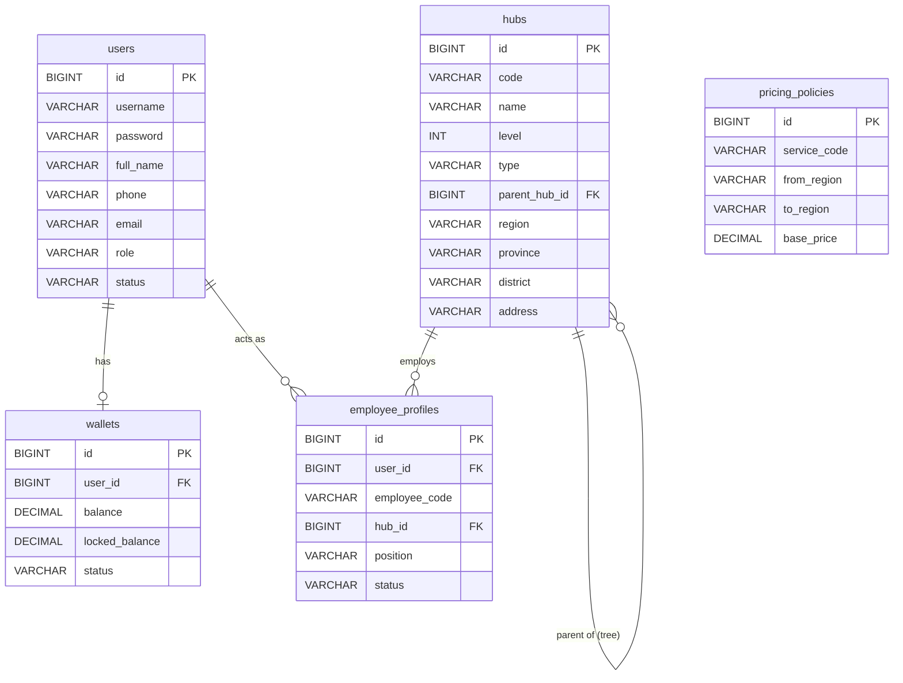
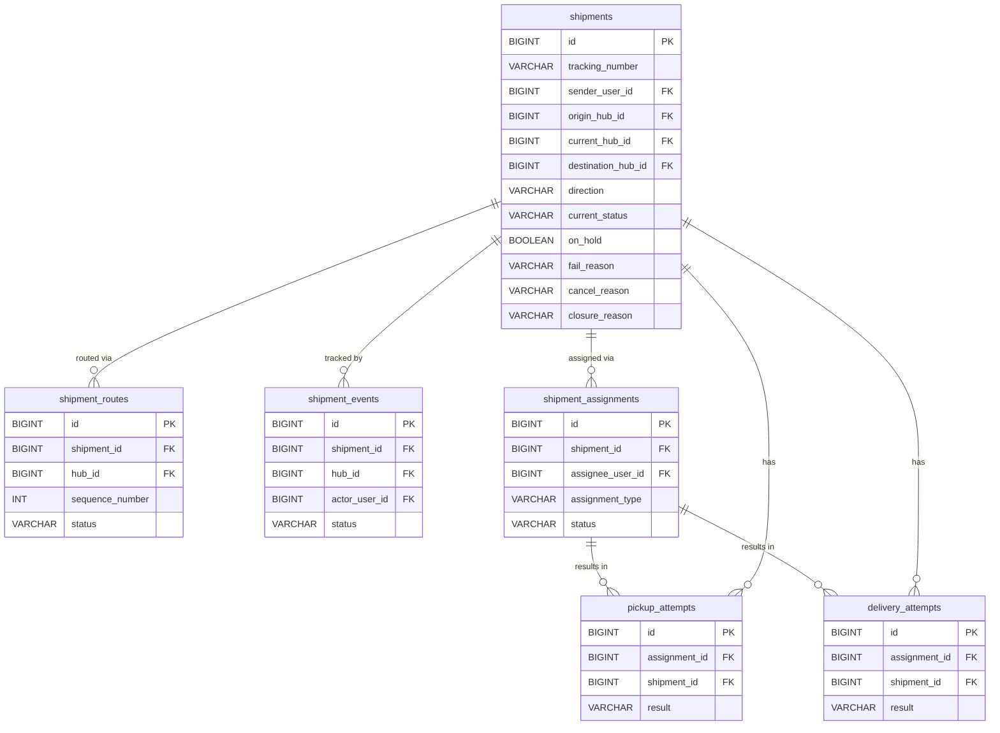
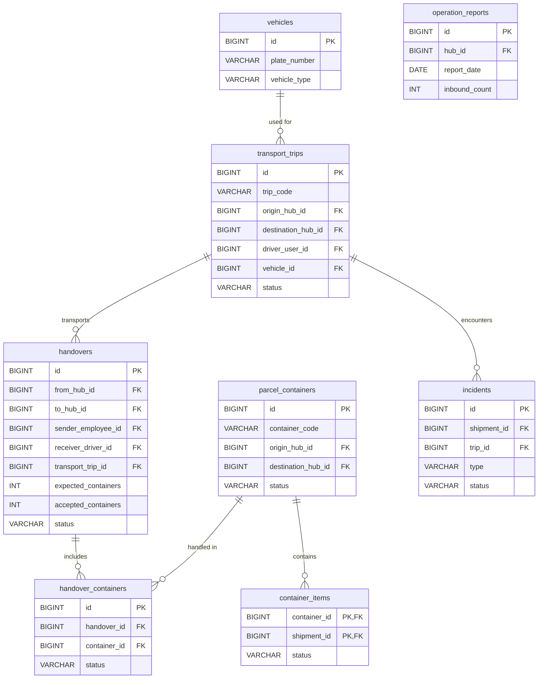
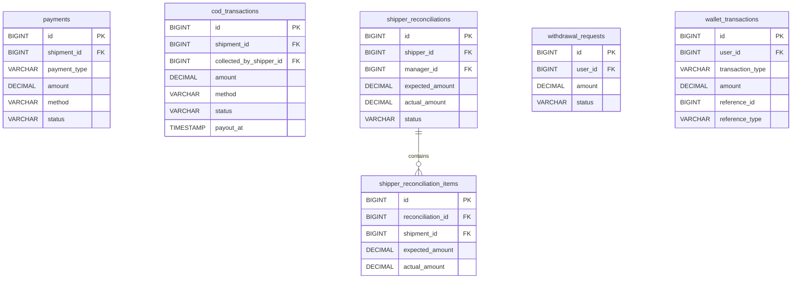

# UTEExpress Entity-Relationship Diagrams (ERD)

Do hệ thống có quy mô lớn với 24 bảng, việc dồn tất cả vào một sơ đồ duy nhất sẽ tạo ra một mạng nhện rất khó đọc. Vì vậy, tôi đã phân chia ERD thành **4 cụm chức năng (Modules)** chuẩn hóa theo tài liệu thiết kế mới nhất `UTEExpress_Workflow.md`.

## 1. Core Module (Người dùng & Cơ sở hạ tầng)
Quản lý thông tin người dùng, nhân viên, phân quyền, bảng ví điện tử độc lập và hệ thống phân cấp Hub.

---

## 2. Shipment & Tracking Module (Vận đơn & Theo dõi)
Lưu trữ thông tin vận đơn với 13 State Machine chuẩn, cờ direction, cờ on_hold, định tuyến dự kiến, lịch sử quét mã (Events), phân công Shipper và các nỗ lực (Attempts).

---

## 3. Linehaul & Operations Module (Vận hành & Trung chuyển)
Quản lý đóng bao (Bagging/Containers), chuyến xe (Trips), bàn giao (Handovers) giữa các trạm, và các sự cố (Incidents).

---

## 4. Financial & Payment Module (Tài chính & Dòng tiền)
Toàn bộ hệ thống quản lý phí vận chuyển, thu hộ COD (phân biệt tiền mặt vs chuyển khoản), đối soát ca cho Shipper (Reconciliation) và lịch sử giao dịch Ví điện tử (Wallet Ledger).

